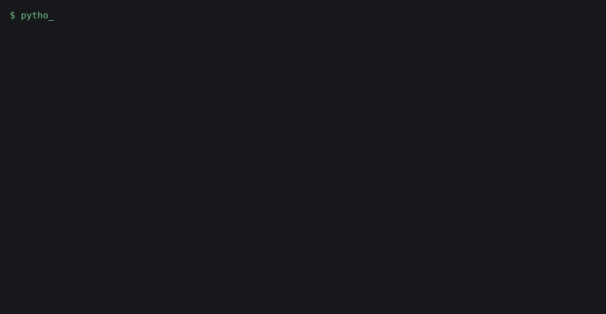

# scrapaud

```
   ____   ____ ____      _    ____   _   _   _ ____
  / ___| / ___|  _ \    / \  |  _ \ / \ | | | |  _ \
  \___ \| |   | |_) |  / _ \ | |_) / _ \| | | | | | |
   ___) | |___|  _ <  / ___ \|  __/ ___ \ |_| | |_| |
  |____/ \____|_| \_\/_/   \_\_| /_/   \_\___/|____/
```

**Recherche multi-moteurs et scraping de pages, listes, wordlists, pastes et `.onion`, en un seul fichier Python.**
*Multi-engine search and scraping toolkit (pages, text lists, wordlists, public pastes, Tor hidden services) — a single Python file, standard library only.*

- Python **3.11+**, **aucune dépendance** à installer
- Un seul script (`scrapaud.py`), ses tests (`test_scrapaud.py`), un modèle de configuration
- Conçu pour des **données publiques** : voir [Usage responsable](#usage-responsable)



---

## Ce que ça fait

| Domaine | Détail |
|---|---|
| **Recherche** | 14 moteurs (SearXNG, Bing, DuckDuckGo, Wikipedia, GitHub, GitLab, Hacker News, Stack Exchange, Archive.org, Wayback Machine, crt.sh, arXiv, OpenAlex, Ahmia) ; résultats **fusionnés et classés** (RRF), dédoublonnés, mis en cache |
| **Catégories** | images, actualités, vidéos, science, fichiers… et période (`--since day/week/month/year`) via une instance SearXNG |
| **Scraping** | liens, listes, tableaux, images, emails, titres, texte ; crawl (`--depth`), même domaine par défaut ; sitemaps ; flux RSS/Atom |
| **Documents** | PDF (via `pdftotext`), Word, Excel, PowerPoint, OpenDocument |
| **Wordlists** | extraction automatique en `.txt` (`--wordlist`), tri par fréquence, mots vides fr/en/de/es/it avec détection de la langue, tableau de bord en direct |
| **Listes de texte** | une entrée par ligne depuis une URL, un fichier ou l'entrée standard (`--textlist`), filtres `--as ips/domains/emails/urls/hashes…` |
| **Pastes** | 25 sites de paste pris en charge, archive pastebin, gists publics GitHub, surveillance (`--watch`), un fichier par paste (`--paste-dir`) |
| **Tor / `.onion`** | client SOCKS5 intégré, résolution DNS côté Tor ; recherche d'onions via Ahmia |
| **Sites dynamiques** | rendu JavaScript avec Chromium sans interface (`--render`) |
| **Interface** | sélection interactive au clavier (`-i`), diagnostic (`--doctor`), autocomplétion bash, sorties `.json .csv .md .html .txt` |

## Installation

```bash
git clone https://forgejo.london.li/London088/scrapaud.git
cd scrapaud
chmod +x scrapaud.py
ln -s "$PWD/scrapaud.py" ~/.local/bin/scrapaud     # optionnel : la commande « scrapaud » partout
scrapaud --doctor                                   # vérifie l'installation
```

Optionnel, détecté automatiquement s'il est présent :

| Outil | Sert à |
|---|---|
| `pdftotext` (paquet `poppler-utils`) | lire les PDF |
| Chromium ou Chrome | `--render` (pages construites en JavaScript) |
| Tor (SOCKS5 sur `127.0.0.1:9050`) | `.onion`, `--tor` |
| Une instance [SearXNG](https://github.com/searxng/searxng) | meilleure recherche, catégories ; voir plus bas |

Autocomplétion bash : `scrapaud --completion bash > ~/.local/share/bash-completion/completions/scrapaud`

## Démarrage rapide

```bash
scrapaud -q "raspberry pi" -e all -n 10                    # tous les moteurs, résultats fusionnés
scrapaud -q "raspberry pi" -i                              # cocher les résultats au clavier
scrapaud -q "chat" --category images --since week          # images récentes (SearXNG)
scrapaud -q "rapport annuel" --filetype pdf --follow -x items    # lire le contenu de PDF trouvés
scrapaud --textlist -q "wordlist subdomains" --filetype txt -n 5 --sort -o mots.txt
scrapaud --wordlist -u https://exemple.com --depth 1 --wl-stopwords auto
scrapaud --sitemap -u https://exemple.com --urls-only      # toutes les URLs du sitemap
scrapaud -u https://exemple.com/feed.xml                   # RSS / Atom
scrapaud --pastebin --grep "mot-cle" --paste-dir           # pastes filtrés, enregistrés en fichiers
scrapaud -u http://xxxx.onion --textlist                   # service .onion via Tor
scrapaud -u https://exemple.com/app --render               # page dynamique (JavaScript)
```

Le **résultat** va sur la sortie standard (pipeable), la **progression** sur la sortie d'erreur :
`scrapaud --sitemap -u … --urls-only | scrapaud -f - --textlist`. Toutes les options : `scrapaud -h`.

### Principales options

| Option | Rôle |
|---|---|
| `-q` / `-Q fichier` | recherche(s) ; `-e` choisit les moteurs (`auto`, `all`, ou une liste), `-p` pages, `-n` limite |
| `-u` / `-f fichier` | URL(s) à lire ; `-f -` lit les URLs sur l'entrée standard |
| `--follow`, `--depth N`, `--max-pages N` | lire les résultats, crawler |
| `-x links,items,tables,images,emails,headings,text` | quoi extraire ; `--main` = contenu principal seulement |
| `--grep`, `--exclude`, `--ext`, `--domain`, `--not-domain` | filtres |
| `--textlist`, `--wordlist`, `--pastes`, `--pastebin`, `--gists` | modes spécialisés |
| `-i` / `--plain` | sélection interactive (curses) ou liste numérotée |
| `-o fichier`, `--json`, `--urls-only`, `--quiet` | sorties |
| `--render`, `--tor`, `--proxy`, `--cookie`, `-H` | réseau et sessions |
| `--doctor [--deep]` | diagnostic de l'installation (le mode `--deep` teste chaque moteur) |

## Sécurité — activée par défaut

- **Cookies et en-têtes** (`--cookie`, `-H`) ne partent **que** vers les sites que tu cibles (`-u`/`-f` ou `--cookie-domain`) — jamais vers les moteurs de recherche — et sont retirés lors d'une redirection vers un autre domaine. Les pages obtenues avec une session ne sont **jamais mises en cache**.
- **Secrets hors de la ligne de commande** : `--cookie @fichier`, `-H @fichier`, ou la variable `SCRAPAUD_COOKIE` (évite `ps` et l'historique du shell).
- **Réseau privé bloqué** (127.x, 10.x, 192.168.x, 169.254.x, CGNAT/Tailscale, IPv6 équivalents) pour tout ce qui est *découvert* (résultats, liens, redirections), y compris via `--render` (proxy local de filtrage), `--proxy` et Tor. Les cibles que tu tapes toi-même restent autorisées ; `--allow-private` / `--allow-host` pour ouvrir.
- **Politesse** : pause `--delay` (0,5 s) **par site**, même en parallèle ; `robots.txt` respecté pour les pages découvertes (`--robots` / `--no-robots` pour forcer).
- **Exports sûrs** : formules de tableur neutralisées dans le CSV, Markdown/HTML échappés, pas de liens `javascript:`.
- **Pages hostiles** : analyse HTML à profondeur bornée (une page à l'imbrication infinie ne fige pas l'outil), téléchargements et décompressions plafonnés.
- **Fichiers créés en privé** : dossiers `700`, fichiers `600` pour les pastes ; refus d'écrire si le disque est presque plein.

Pas de résolution automatique de captcha, **par choix** : si un site bloque, utilise une session ouverte à la main (`--cookie`), un proxy, une API officielle — ou renonce.

## Wordlists et pastes

```bash
scrapaud --wordlist -q "cuisine" -n 5 --wl-stopwords auto      # -> ~/wordlists/scrapaud/<sujet>_<date>/wordlist.txt + manifest.json
scrapaud --pastebin --grep "regex" --paste-dir                  # -> ~/pastes/scrapaud/<site>/<date>/<id>_<titre>.txt + index.md
```

- Wordlists : mots réellement présents dans les sources, triés par fréquence (`--wl-sort`), avec `--wl-split` (un fichier par source), `--wl-lower`, `--wl-min`, etc. L'outil **n'invente ni ne mute** de mots.
- Pastes : texte complet enregistré, jamais de doublon, `index.md` avec liens ; sans `--paste-dir` rien n'est écrit sur le disque.

## SearXNG (optionnel, recommandé)

Les moteurs grand public bloquent souvent les requêtes automatisées. Une instance **SearXNG locale** agrège plusieurs moteurs et évite ces blocages. `scrapaud` la détecte sur `http://127.0.0.1:8888`, ou avec `--searx URL` / `SCRAPAUD_SEARX`. Dans son `settings.yml`, activer le format JSON : `search: { formats: [html, json] }`, et écouter sur `127.0.0.1` uniquement.

## Configuration

Fichier TOML optionnel `~/.config/scrapaud/config.toml` (modèle : [`config.example.toml`](config.example.toml)) — les clés sont les noms d'options sans `--` ; la ligne de commande prime.
Variables : `SCRAPAUD_SEARX`, `SCRAPAUD_TOR`, `SCRAPAUD_COOKIE`, `SCRAPAUD_CONFIG`, `SCRAPAUD_CACHE`, `NO_COLOR`.

## Tests

```bash
python3 -m unittest test_scrapaud        # ≈ 1 minute, hors ligne
```

170 tests, sans accès à Internet : serveurs HTTP locaux, faux serveur SOCKS5 pour Tor, interface curses pilotée dans un pseudo-terminal, vrai Chromium pour le rendu (ignoré s'il est absent). Les tests qui ont besoin d'un outil absent (`pdftotext`, navigateur) sont ignorés.

## Limites connues

- Les moteurs gratuits changent ou bloquent sans prévenir : DuckDuckGo est intermittent, Ahmia, crt.sh et arXiv sont parfois en panne ou limitent le débit. `scrapaud --doctor --deep` dit ce qui répond.
- Plusieurs sites de paste refusent les robots (rentry.co, dpaste.org, justpaste.it…) ou effacent vite leurs pastes ; ils ne sont pas contournés.
- Les heuristiques (contenu principal d'une page, choix des listes et colonnes, détection de langue) sont des estimations et se trompent parfois.
- Avec `--proxy`, le filtre du réseau privé ne peut pas s'appliquer au navigateur de `--render` (un avertissement le signale).
- Testé sous **Linux Mint 22** (base Ubuntu 24.04). Non testé sous macOS ni Windows.

## Usage responsable

`scrapaud` lit des **contenus publics**. Respecte les lois applicables, les conditions d'utilisation des sites et leurs limites de débit. Ne l'emploie pas pour accéder à des systèmes ou des données sans autorisation, ni pour collecter des données personnelles sans base légale. Les pastes publics et les services `.onion` peuvent contenir des données sensibles ou illicites : l'outil n'indexe pas de marchés illicites, et c'est à l'utilisateur d'agir de façon légale. Les auteurs déclinent toute responsabilité en cas d'usage abusif.

## Licence

[MIT](LICENSE).
